# edge-voice-notes

[](https://github.com/rromero-emb/edge-voice-notes/actions/workflows/ci.yml)

Offline voice notes for a small ARM board: **record → crash-safe queue → transcribe (whisper.cpp) → summarise (llama.cpp)**.
Nothing leaves the device. The target is a battery-powered recorder (e.g. a Qualcomm QCS6490 board such as the
Radxa Dragon Q6A, or a Raspberry Pi 5) that can lose power at any moment.

It is the software core of such a device, written the way embedded software has to be:

- **Survives power loss.** Every artefact is written with temp file + `fsync` + rename + directory `fsync`.
  The queue is SQLite in WAL mode with `synchronous=FULL`. Transcription is checkpointed per chunk (5 min by default)
  and summarisation per section, so a 60-minute recording interrupted at minute 50 resumes at minute 45, not from zero.
- **Interrupted recordings are kept.** The recorder `fsync`s the WAV every 5 s; on the next boot `evn recover` repairs the
  header that the recorder never finalised and queues the audio.
- **No reboot loops.** A recording that kills the process every time (OOM, driver bug) is parked as `failed` after
  3 attempts *without progress*; the rest of the queue keeps moving.
- **Engines are swappable.** The pipeline only sees two small interfaces (`Transcriber`, `Summariser`). whisper.cpp
  and llama.cpp are the default backends; an NPU backend or another model server is one class. CI runs everything with
  deterministic fake engines, no models downloaded.
- **Nothing invented in the action items.** The LLM proposes, plain code checks: an action item is kept only if its
  owner or its deadline is actually said at the line it cites (or the line just before it, for "Lucia, can you…?" /
  "Sure, by Monday."), a past reference ("last week") is never a deadline, and a decision must cite a line that says
  something was decided or agreed. Every item is mapped back to the timestamp of a real transcript line. These rules are
  measured by an [evaluation set](#evaluation) in CI.
- **Traceable.** Each recording's `status.json` records the engine binaries, model file names and SHA-256, timings and
  real-time factor, so any summary can be traced to the exact models that produced it.
- **Stdlib only.** Python ≥ 3.11 and nothing else at runtime (Debian 12 / Armbian has it). The models run as separate
  processes, so an out-of-memory kill takes `whisper-cli`, not the queue.

## Pipeline

```mermaid
flowchart LR
    MIC[ALSA mic] -->|arecord, fsync every 5 s| PART[incoming/id.wav.part]
    PART -->|stop: finalise · power cut: repair header| ING[ingest]
    ING --> DB[(queue.db<br/>SQLite WAL)]
    DB --> W[worker]
    W -->|silence-aware chunks| WH[whisper-cli]
    WH -->|chunk_NNNN.json checkpoints| TR[transcript.json / .txt]
    TR -->|sections ≤ 3000 chars| LL[llama-server<br/>JSON-schema output]
    LL --> V[validator<br/>timestamps, owners, deadlines]
    V --> OUT[summary.md · actions.json · status.json]
```



Per recording, in `recordings/<id>/`:

| File | Content |
|---|---|
| `audio.wav` | the recording, 16 kHz mono PCM, never modified after ingest |
| `transcript.json`, `transcript.txt` | segments with absolute timestamps (`[mm:ss] text`) |
| `summary.md` | overview, per-section key points, decisions, action items; every item has a `[mm:ss]` reference |
| `actions.json` | decisions and action items (owner/deadline only when stated), plus the rejected ones and why |
| `status.json` | state, attempts, engine/model identity and SHA-256, timings, real-time factor |

## How the crash safety is tested

`tests/test_crash.py` runs the real CLI as a subprocess with the fake engines, `SIGKILL`s it at random instants,
restarts it, and repeats until the queue drains. The final transcripts, summaries and action lists must be
**byte-identical** to an uninterrupted run, and no temp files may be left. CI runs 5 seeds (each one needs about 10 to 20
kills to finish) on x86_64, on aarch64, and in a Debian 12 container. A second test makes one recording kill the process at
the same chunk every time and checks it is parked as failed while the other recordings complete.

I also ran the same experiment by hand with the real engines: killing the worker during the third minute of
whisper.cpp transcription of a 6-minute file and restarting resumed at chunk 3 of 6, and the transcript was
byte-identical to an uninterrupted run.

`SIGKILL` proves the checkpoint logic. A real power cut additionally depends on the `fsync` discipline, the
filesystem and the storage. That part has to be verified on the target hardware: [docs/POWER_LOSS.md](docs/POWER_LOSS.md)
describes the procedure.

## Benchmark (laptop baseline, not the target board)

`tools/bench.py` measures the two expensive phases with the real engines. Numbers from my development laptop, so
they are a **baseline for comparison, not a prediction for an ARM board**. The first thing to measure on the target is
exactly this table.

| Phase | Setup | Result |
|---|---|---|
| Transcription | whisper.cpp 1.9.5, `ggml-base.en`, 4 threads, 6 min of speech | **RTF 0.21** (77 s), peak RSS 407 MB |
| Summary | llama.cpp `llama-server`, Qwen2.5-1.5B-Instruct Q4_K_M, 5-min meeting transcript, 2 sections + overview | **93 s**, server peak RSS 2.2 GB |

Machine: Intel i7-1355U (laptop, not idle during the run), Debian 12. Full output in
[`bench/results-x86-i7-1355u/`](bench/results-x86-i7-1355u/).

Quality check (13-nov, before the stricter validator of the [evaluation](#evaluation) section) on [`bench/meeting_en.txt`](bench/meeting_en.txt), a scripted 5-minute meeting with 4 explicit action
items and 3 vague ones ("someone should check…", "I'll do it next sprint"):

| | Result with the 1.5B model |
|---|---|
| Explicit actions found | 3 of 4 (missed "Ana will order ten more enclosures this week") |
| Owners/deadlines correct | 3 of 3 (one deadline shortened from "by next Tuesday" to "by Tuesday") |
| Vague items listed as actions | 0 of 3 |
| Invented owners or dates | 0 (the validator removed the model's attempts to put timestamps in the deadline field) |
| Decisions found | 2 of 3 |

The 1.5B model is usable but its key points are weak; a 3B model is the realistic choice if memory allows. Choosing
the model is a measurement on the target, not a guess.

Note on reproducibility: transcripts are deterministic. `llama-server` at temperature 0 is not bit-exact across runs
(batching), so a resumed summary can differ in wording from an uninterrupted one; the byte-identity test in CI uses the
fake engines.

## Evaluation

[`evals/`](evals/) holds a small labelled set and a scorer, so changes to prompts, models or the validator are
measured instead of eyeballed.

- **Dataset:** 5 scripted English meetings ([`evals/cases/`](evals/cases/)), 7 expected action items, 6 expected
  decisions and 6 traps: vague items that must *not* become actions ("someone should look at the logging rate",
  "maybe we could ask Pedro…", "I'll think about the pricing"). One case has no actions at all, one gives owners and
  deadlines across dialogue turns. All names are fictional.
- **Metrics:** action precision/recall (keyword matching, one-to-one), invented actions (anything not in the labels),
  trap leaks, owner/deadline accuracy on matched actions, timestamp accuracy, decision precision/recall, and WER with
  Whisper's basic text normaliser (reimplemented with the stdlib).
- **Baseline vs current:** both rows score the *same* model output. *baseline* takes the model's action items as they
  come (a naive "ask the LLM for action items" integration); *current* runs them through the validator. The difference
  is the validator, not the model.

Results on my laptop (i7-1355U), Qwen2.5-1.5B-Instruct Q4_K_M via `llama-server`, temperature 0, 5 cases in 115 s:

| Pipeline | Action P | Action R | Invented | Trap leaks | Owner ok | Due ok | Decision P | Decision R |
|---|---|---|---|---|---|---|---|---|
| baseline (raw model output) | 0.42 | 0.71 | 7 | 5 | 1.00 | 0.40 | 0.38 | 1.00 |
| **current (validated)** | **1.00** | 0.71 | **0** | **0** | 1.00 | 0.40 | **1.00** | 1.00 |

WER, whisper.cpp `ggml-base.en`: 0.000 on the 11 s JFK sample shipped with whisper.cpp (22 words). Full output:
[`evals/results/x86-qwen2.5-1.5b/`](evals/results/x86-qwen2.5-1.5b/).

What the set showed, and what changed because of it: the first run had the model attach "Tomas" (named on the next
line) to an unrelated task, take "last week" as a deadline, and list almost every line as a decision (precision 0.38).
The validator now checks owners and deadlines at the cited line, rejects past references and requires a decision cue.
What it still gets wrong: the model misses the dialogue-style hand-over ("Lucia, can you…?" / "Sure, by Monday"), drops
or truncates deadlines ("by next Monday" lost, "before the review on the 12th" shortened to "12th"), and once moved a
deadline from the line above onto a neighbouring task. Recall (0.71) is the model's limit; the validator only removes.

CI runs the same set with the fake engines (under a second) as a regression gate
([`evals/thresholds.json`](evals/thresholds.json)): it fails if an invented action or a trap leak appears, or if
recall drops. The fake summariser is rule-based, so the gate tests the validator and the scorer, not a model.

```sh
PYTHONPATH=src python3 evals/run_evals.py --engine fake --out /tmp/evals          # CI, no models
PYTHONPATH=src python3 evals/run_evals.py --engine real --llama-url http://127.0.0.1:8080 \
    --whisper-bin ~/src/whisper.cpp/build/bin/whisper-cli --whisper-model ~/src/models/ggml-base.en.bin \
    --out evals/results/<machine>-<model>
```

Limits, read before quoting the numbers: 5 synthetic cases is a smoke test, not a benchmark, and the rules were tuned
while looking at them, so expect lower numbers on real meetings. Keyword matching is coarse. WER is measured on one
clean 11 s clip because there is no TTS or recorded meeting audio in this repo yet. `llama-server` is not bit-exact
across runs, so the baseline row moves a little between runs. All numbers are from an x86 laptop, **not** from an ARM
board.

## Quick start

```sh
git clone https://github.com/rromero-emb/edge-voice-notes && cd edge-voice-notes
export PYTHONPATH=$PWD/src

# 1. Try the whole flow with the fake engines (no models needed)
python3 -m edge_voice_notes example-config | sed 's|/var/lib/edge-voice-notes|/tmp/evn|; s|"whisper_cpp"|"fake"|; s|"llama_server"|"fake"|' > /tmp/evn.toml
python3 -c "from edge_voice_notes import audio; audio.write_tone_bursts('/tmp/test.wav', 120)"
python3 -m edge_voice_notes -c /tmp/evn.toml enqueue /tmp/test.wav
python3 -m edge_voice_notes -c /tmp/evn.toml run --once
python3 -m edge_voice_notes -c /tmp/evn.toml status
cat /tmp/evn/recordings/*/summary.md

# 2. Tests (stdlib unittest)
PYTHONPATH=src:tests python3 -m unittest discover -s tests -t tests
```

With the real engines, build [whisper.cpp](https://github.com/ggml-org/whisper.cpp) (`whisper-cli`) and
[llama.cpp](https://github.com/ggml-org/llama.cpp) (`llama-server`), download a whisper ggml model and a small
instruct GGUF, start `llama-server -m model.gguf -c 4096 --host 127.0.0.1 --port 8080`, and point
`[transcriber]` and `[summariser]` in the config at them (`evn example-config` prints a commented config).

```
evn record [--seconds N] [--device hw:1,0]   record from ALSA until SIGINT/SIGTERM, then queue
evn enqueue FILE.wav...                       queue existing 16 kHz mono 16-bit WAVs
evn run [--once]                              recover, then process the queue
evn recover                                   repair interrupted recordings, re-queue orphans
evn status [--json]                           list recordings, state, RTF, actions
evn retry ID                                  re-queue a failed recording
```

## On the device

`deploy/` has systemd units:

- `llama-server.service`: keeps the summary model loaded, localhost only.
- `evn-worker.service`: runs `evn run` (recover, then the queue), `Nice=10` and idle I/O class so recording has
  priority. `IPAddressDeny=any` / `IPAddressAllow=localhost`: **offline is enforced by the kernel**, not just by
  configuration. Uncomment `ConditionACPower=true` to process only on external power.
- `evn-record.service`: started and stopped by a button handler; `KillSignal=SIGINT` so the WAV is finalised.

Transcription and summary never run at the same time (the worker is sequential), so peak memory is the larger of
the two models, not the sum. That is what decides between an 8 GB and a 16 GB board.

## Adding an engine

```python
from edge_voice_notes.engines import TRANSCRIBERS, Segment, Transcriber

class MyNpuWhisper(Transcriber):
    def __init__(self, model: str): ...
    def transcribe(self, wav):            # 16 kHz mono chunk, times relative to the chunk
        return [Segment(0, 2100, "Hello there.")]
    def info(self):                       # goes to status.json
        return {"engine": "my-npu", "model": "..."}

TRANSCRIBERS["my_npu"] = MyNpuWhisper    # then: [transcriber] engine = "my_npu"
```

## Layout

```
src/edge_voice_notes/
  pipeline.py     ingest, recover, worker, per-chunk / per-section checkpoints
  jobqueue.py     SQLite queue, attempt counter reset on progress
  audio.py        WAV checks, header repair, silence-aware chunk planning
  notes.py        sections, prompts, JSON schemas, validation of timestamps/owners/deadlines, rendering
  recorder.py     arecord wrapper with periodic fsync
  fsutil.py       atomic writes
  engines/        base interfaces, whisper.cpp, llama-server, fakes
tests/            unittest: audio, validation, pipeline, recorder, engines (stub binaries/HTTP), SIGKILL resume
evals/           labelled cases, scorer (WER, action P/R, traps), run_evals.py, thresholds, results
tools/bench.py    real-engine benchmark
deploy/           systemd units
```

## Not done yet

- Measurements on the target board (RTF, summary time, power per phase) and real power-cut testing on its storage.
- NPU/GPU backends (e.g. Qualcomm QNN for whisper on the QCS6490).
- Encrypted storage (LUKS volume unlocked at boot) and the USB-network download page.
- Speaker labels (diarisation).
- Evaluation on recorded meeting audio (WER on real speech, end to end) and a second model to compare.

## License

MIT
